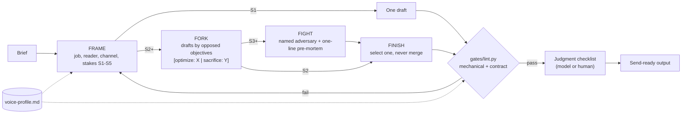

# drafting-harness

[](https://github.com/gkmr/drafting-harness/actions/workflows/tests.yml)   [](LICENSE)

A Claude skill and a stdlib Python gate for drafting messages that have to work: fork
drafts by opposed objectives, attack them with a named adversary, select one, and let a
script (not the model) decide whether the result ships.

## The problem

I built this because asking a model for "a few options" gave me the same message at
three temperatures, and asking it to "avoid AI tells" gave me a confident yes and an em
dash in line two. I wanted drafts that differ in what they are trying to win, a reason
to pick one, and checks the model cannot talk its way past. This repo is the method
from my personal writing system with the personal parts removed.

## How it works



- **FRAME** sets the job (what the reader should do), the reader (a role in a state), the
  channel and the stakes tier. A missing recipient or goal stops the run with two or
  three questions instead of an invented one.
- **FORK** writes two or three drafts, each tagged with what it optimizes and what it
  sacrifices. Tone is never an objective.
- **FIGHT** (S3 and up) picks the reader most likely to reject the draft, by role
  ("the skeptical CFO reading on her phone"), and writes one line on the worst plausible
  outcome two weeks after sending.
- **FINISH** selects one draft by letter, with a one-line reason and a decision tree for
  the replies. At most one sentence is grafted from another draft.
- **Gates.** `gates/lint.py` checks each draft for its channel and checks the whole
  output against the tier's contract. Judgment checks (register, does the fork really
  split this reader) stay a ranked checklist in the skill.

The output shape per tier is in [templates/output-contract.md](templates/output-contract.md).
The reasoning, the axis library and the adversary library are in
[docs/method.md](docs/method.md).

## Quickstart

Python 3.8 or later, no dependencies.

```bash
# lint a draft for its channel (the file's first line can name it: "channel: slack")
python3 gates/lint.py examples/drafts/bad/01-slack-table-and-filler.txt

# the same, with a personal voice profile (keep words, extra bans, tighter caps)
python3 gates/lint.py examples/drafts/good/01-slack-pilot-update.txt --profile templates/voice-profile.example.md

# check a full S3 output against its contract, then lint the drafts inside it
python3 gates/lint.py examples/outputs/s3-pilot-extension.md --contract
python3 gates/lint.py examples/outputs/bad-s2-fake-fork-merge.md --contract

# pipe a draft in
echo "Let's circle back next week." | python3 gates/lint.py - --channel slack

# run the tests
python3 -m unittest discover -s tests -v
```

To use the skill, copy `skills/drafting-harness/` into your Claude skills folder along
with `gates/` and `templates/`, then copy `templates/voice-profile.example.md` to
`voice-profile.md` and replace the invented persona with your own evidence.

## How it is verified

- **57 unit tests** (`tests/test_lint.py`) cover every draft rule and every contract rule,
  with a positive and a negative case for the rules most likely to misfire (spaced hyphens
  and CLI flags are not em dashes; "the email that said yes" is not "that said,").
- **An example corpus with recorded verdicts.** `examples/expected.json` lists 13 files: 7
  that must pass and 6 that must fail with named rules. The test suite fails if any
  verdict changes or if a file in `examples/` is not listed.
- **The contract gate checks the method itself.** A fork whose objectives are tones, two
  drafts optimizing the same thing, a recommendation naming two drafts, "best of both
  worlds", or "Named adversary: a skeptic" each fail by name.
- **Exit codes for automation.** 0 pass, 1 any FAIL, 2 usage error; `--json` for
  machines. WARN findings never fail a run.

## Design decisions and tradeoffs

- **Fork on objectives, not tone.** Tags like `[optimize: urgency | sacrifice: room to
  recover]` make each draft's bet explicit and let a script reject fake forks. The cost
  is more thinking per draft; S1 messages skip the fork entirely.
- **Select, never merge.** Merging averages the objectives and wins none. One strictly
  additive sentence can be grafted and is recorded on its own line. The cost: sometimes
  a good phrase in a losing draft is left behind.
- **Output scales with stakes, not effort.** A one-line confirmation gets one line. The
  asymmetric defaults (unclear S1 or S2 goes down; unclear S2 or S3 goes up) target the
  two failures I hit most: padding routine messages and under-preparing hard ones.
- **Scripts judge what is countable; the checklist judges the rest.** Em dashes, banned
  phrases, length caps and contract shape are regexes and counts. Register fit is not,
  so it stays in the skill as a ranked checklist instead of a fake score.
- **Method and voice are separate files.** The method ships; a voice profile stays with
  its owner. Registers are keyed by relationship role, never by named person, so the
  profile generalizes and holds no private contacts.
- **Banned words are data, not code.** `gates/banned.tsv` is editable and each line
  carries its fix. A profile's "Keep words" exempt a word the writer really uses.

## Limitations

- The banned list is English and opinionated. It catches common AI tells, not all of
  them, and a clean lint does not mean a draft is good.
- Sentence splitting is a regex. Abbreviations ("e.g.", "U.S.") can over-count
  sentences and trip the soggy-middle rule.
- Channel caps are defaults from one person's practice (Slack top-level 600 characters,
  email 120 words, a text bubble 160 characters). Tune them in the voice profile.
- The contract gate checks shape, not substance. It can tell that two objectives differ;
  it cannot tell whether this reader would react differently to them.
- The skill text tells the model to run the gates. In a host with no shell, the gates
  are applied by hand and the output says so.

## Layout

```
drafting-harness/
├── skills/drafting-harness/SKILL.md   the method, generic, for any user
├── templates/
│   ├── output-contract.md             output shape per stakes tier S1-S5
│   └── voice-profile.example.md       the personal layer, invented persona
├── docs/method.md                     why it works; axis and adversary libraries
├── gates/
│   ├── lint.py                        mechanical and contract gate, stdlib only
│   └── banned.tsv                     banned phrases with fixes
├── examples/
│   ├── drafts/good/                   4 drafts that pass
│   ├── drafts/bad/                    4 drafts that fail, one per failure family
│   ├── outputs/                       S1, S2, S3 outputs that pass; 2 that fail
│   └── expected.json                  the verdict each example must get
├── tests/test_lint.py
├── CHANGELOG.md
└── LICENSE
```

All names, companies and numbers in `examples/` and `templates/` are invented.
